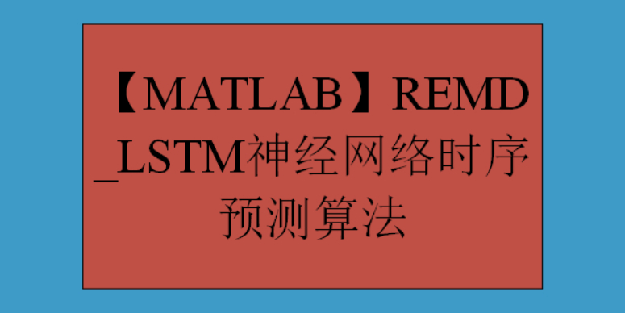

# [MATLAB] REMD_LSTM Neural Network Time Series Forecasting Algorithm

REMD-LSTM neural network time series prediction algorithm is a method that combines the REMD (Reservoir Enhanced Multi-scale Deep Learning) algorithm with the Long Short-Term Memory (LSTM) neural network for time series prediction.
The REMD (Reservoir Enhanced Multi-scale Deep Learning) algorithm is a time series prediction method that integrates Ensemble Empirical Mode Decomposition (EEMD) and deep learning models such as LSTM.
The basic idea of the REMD algorithm is to decompose the original time series through EEMD, obtaining a set of Intrinsic Mode Functions (IMF) and a residual term. These IMF can better represent complex patterns and trends in the time series, providing a more accurate data representation for subsequent predictions. Then, these IMF are used as inputs to the deep learning model for training and prediction.
The advantage of the REMD algorithm lies in its ability to handle nonlinear, non-stationary time series data and learn long-term dependencies in the time series. EEMD can extract complex patterns and trends in the time series, providing a more accurate input data for the deep learning model. Meanwhile, the deep learning model can learn these patterns and trends' long-term dependencies, further improving the accuracy and stability of predictions.
In practical applications, the REMD algorithm can be applied to various fields, such as financial market prediction, meteorological forecasting, energy consumption prediction, etc. However, there are some potential limitations of this algorithm, such as high computational complexity and the need for large amounts of data. Therefore, it is necessary to adjust and optimize the algorithm according to actual needs when using it.
LSTM is a deep learning model that is particularly suitable for processing time series data with long-term dependencies. LSTM introduces memory units to learn and remember historical information, allowing the model to consider patterns and trends over a long period during time series prediction.
The REMD-LSTM algorithm primarily involves decomposing the raw time series using EEMD to obtain a set of Intrinsic Mode Functions (IMF) and a residual term. These IMFs are then used as inputs for the LSTM model, which is trained and predicted through multiple independent LSTM models with distinct initialization conditions and parameter settings. Each LSTM model processes the time series, leading to predictions that are then aggregated, such as by averaging or weighted averaging, to produce the final prediction results.

The strength of the REMD-LSTM algorithm lies in its ability to handle nonlinear, non-stationary time series data and learn long-term dependencies within the sequence. EEMD extracts complex patterns and trends from the time series, providing more accurate input data for the LSTM. Meanwhile, the LSTM is capable of learning these patterns and trends' long-term dependencies, further enhancing the accuracy and stability of predictions.

In practical applications, the REMD-LSTM algorithm can be utilized across various fields, such as financial market forecasting, weather forecasting, energy consumption prediction, etc. However, it should be noted that this algorithm also has some potential limitations, such as high computational complexity and the need for large amounts of data. Therefore, when using this algorithm, adjustments and optimizations should be made based on actual needs.

## Images

<!-- PAYMENT_BLOCK -->

## Get this dataset

- Payment link (Stripe): [Buy now](https://buy.stripe.com/3cs8yP7sY87d0vu9AB)
- Payment QR code: 

<!-- /PAYMENT_BLOCK -->
